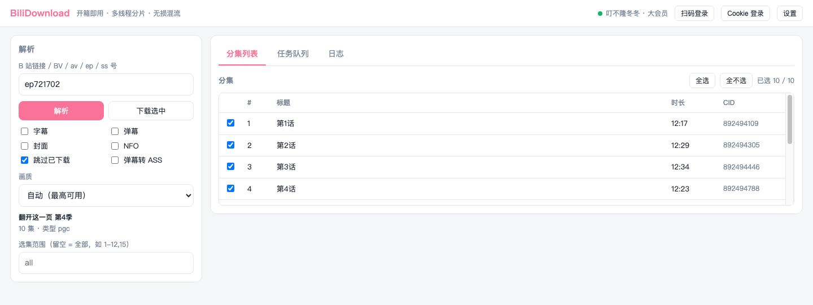

# BiliDownload

B 站批量下载工具 —— 开箱即用、多线程分片、无损混流。

本仓库实现 PRD 中的 **M1 命令行 MVP + M2 图形界面 + M3 命名模板/字幕弹幕/媒体库元数据/打包发布**：链接解析 → 批量队列 → 多线程分片下载 → ffmpeg `-c copy` 无损混流。界面是**内置 HTTP 服务 + 浏览器渲染**，零第三方依赖；仅依赖 Python 3.8+ 标准库，无需 `pip install`（ffmpeg 是唯一的外部依赖，用于无损封装）。

> **为什么界面用浏览器而不是 tkinter**：macOS 26 (Tahoe) 自带的 Tk 8.5.9 存在渲染缺陷——`Label`/`Entry`/`Text`/`Listbox`/`Canvas` 的文字与**全部 ttk 控件**都不绘制，窗口会呈现整片空白（按钮之外的区域全白）。这是 Tk 自身问题，与业务代码无关。改用本地 HTTP 服务 + 浏览器渲染后彻底规避，且界面更灵活。当时的对照实验截图见 [`docs/tk8.5-render-bug.jpg`](docs/tk8.5-render-bug.jpg) 与 [`docs/tk-ttk-compare.jpg`](docs/tk-ttk-compare.jpg)。



## M3 新特性

- **命名模板增强**：支持中文别名与丰富占位符（画质/编码/年份/日期/季/分P/时长），`{index:03d}` 等格式说明符：`{系列名}/S{season:02d}E{index:02d} - {标题}.{ext}`。用 `python3 -m bili_downloader template --list` 查看全部占位符。
- **媒体库元数据**：生成标准 `episodedetails` NFO、`tvshow.nfo`、`season.nfo`，便于 Emby/Jellyfin/Plex 刮削。
- **弹幕 ASS**：`--danmaku-ass` 把 B 站 `danmaku.xml` 转成 ASS 字幕（带颜色/字号/位置），播放器可直接加载。
- **打包发布**：`python3 build.py` 用标准库 zipapp 生成单文件 `.pyz` + 各平台启动器；可选 `--pyinstaller` 生成独立二进制。

### 命名模板占位符

`{series}`/`{系列名}`、`{title}`/`{标题}`、`{index}`/`{集数}`、`{season}`/`{季}`、`{page}`/`{分P}`、`{bvid}`、`{aid}`、`{cid}`、`{quality}`/`{画质}`、`{qn}`、`{codec}`/`{编码}`、`{year}`/`{年份}`、`{date}`/`{日期}`、`{pubdate}`、`{duration}`/`{时长}`、`{ext}`。数字占位符支持 `:02d`/`:03d` 格式，集数默认补零两位。

## 图形界面（浏览器界面）

```bash
python3 gui.py                    # 启动并自动打开浏览器
python3 -m bili_downloader --gui  # 同上
python3 -m bili_downloader --web --port 8899 --no-browser   # 指定端口、不自动开浏览器
python3 -m bili_downloader.webserver --port 8899            # 也可直接跑该模块
```

启动后终端会打印地址（如 `http://127.0.0.1:8899/`），浏览器打开即是完整界面。

界面功能：
- **左侧解析面板**：粘贴链接 → 点“解析”列出全部分集；字幕/弹幕/封面/NFO/跳过已下载/弹幕转 ASS 勾选；画质下拉；选集范围（`1-12,15`）。已选分集数量实时显示。
- **分集列表**：表格带复选框，支持全选/全不选；显示序号、标题、时长、CID。
- **任务队列**：实时进度条、速度、大小、状态下拉标签；暂停/继续/取消/移除；恢复未完成/重试失败/清除已完成。
- **扫码登录**：内置二维码生成器（纯标准库实现，支持版本 1-10 / 纠错 M / 字节模式），弹窗里直接显示可扫的二维码；登录成功后登录状态实时刷新。
- **Cookie 登录**：粘贴 `SESSDATA=...; bili_jct=...` 整串即可。
- **设置面板**：下载目录、单文件线程数、并发任务数、限速、分片大小、命名模板、编码偏好、代理。

深链：`http://127.0.0.1:8899/?url=BV1xx411c7mD` 打开即自动解析；`?tab=task` 直达任务页；`?login=qr` 直接弹扫码窗。

所有网络与下载操作都在后台线程，页面每秒轮询进度，不卡顿。

## 功能（M1）

- **链接解析**：BV/av 号、`video/BV`、`bangumi/play/ep`、`bangumi/play/ss`（自动展开整季）、UP 主空间、收藏夹。
- **批量选集**：`--range 1-12,15,18-20` 区间/逗号选择，默认全选。
- **多线程分片**：单文件 4–32 线程（默认 8），支持 CDN 备节点切换、失败重试。
- **断点续传**：分片级续传，程序重启后 `resume` 恢复未完成任务。
- **无损混流**：DASH 音视频分离下载后调用内置 ffmpeg `-c copy` 封装，**不转码**。
- **清晰度/编码**：自动选最高画质，可指定 qn；编码偏好 AVC/HEVC/AV1 回退；支持仅下载音频。
- **扫码登录**：Cookie 本地加密保存，`nav` 与 WBI 签名接口支持会员画质。
- **并发队列**：可配置同时任务数（默认 2），暂停/继续/取消/失败重试。
- **文件管理**：命名模板、字幕/弹幕/封面/NFO 元数据可选下载、下载历史去重。
- **限速/代理**：全局字节限速、HTTP/SOCKS5 代理。

## 安装

```bash
# 无需 pip 安装依赖，但需要 ffmpeg（用于无损混流）
# macOS:  brew install ffmpeg
# Ubuntu: sudo apt install ffmpeg
# Windows: 从 https://ffmpeg.org/download.html 下载并加入 PATH
```

运行：

```bash
python3 -m bili_downloader --help
# 或（使用入口脚本）
python3 main.py --help
```

## 快速开始

```bash
# 1. 登录（扫码；也可 --cookie "SESSDATA=xxx; bili_jct=yyy; ..."）
python3 -m bili_downloader login
python3 -m bili_downloader login --status

# 2. 解析链接，查看分集
python3 -m bili_downloader parse "https://www.bilibili.com/bangumi/play/ss38317"

# 3. 下载整季（默认全部、自动最高画质、8 线程、2 并发）
python3 -m bili_downloader download "https://www.bilibili.com/bangumi/play/ss38317"

# 4. 选集 + 指定画质 + 下载字幕/封面/NFO
python3 -m bili_downloader download "BV1xx411c7mD" \
    --range 1-12,15 --quality 80 --subtitle --cover --nfo --dir ./my-videos

# 5. 中断后恢复 / 查看任务 / 失败重试
python3 -m bili_downloader resume
python3 -m bili_downloader tasks
python3 -m bili_downloader tasks --retry-failed && python3 -m bili_downloader resume

# 6. 配置
python3 -m bili_downloader config            # 查看全部配置
python3 -m bili_downloader config threads 16 # 修改单文件线程数
```

## 配置

配置文件默认位于 `~/.bilidownload/config.json`（可用 `--config` 或环境变量 `BILI_HOME` 指定目录）。

| 配置项 | 默认值 | 说明 |
| --- | --- | --- |
| `download_dir` | `./downloads` | 下载根目录 |
| `threads` | `8` | 单文件分片线程数 (1–32) |
| `concurrency` | `2` | 同时下载任务数 |
| `quality` | `0` | 画质 qn，0=自动最高 |
| `codec_pref` | `AVC,HEVC,AV1` | 编码回退优先级 |
| `name_template` | `{series}/{index} - {title}.{ext}` | 命名模板 |
| `speed_limit_kbps` | `0` | 限速 KB/s，0=不限 |
| `proxy` | `""` | `http://` 或 `socks5://` |
| `retries` | `3` | 失败重试次数 |
| `chunk_size_mb` | `4` | 分片大小 |
| `request_interval` | `0.5` | API 请求最小间隔（降低风控） |
| `save_subtitle/danmaku/cover/nfo` | `false` | 辅助资源开关 |
| `dedup` | `true` | 已下载去重 |
| `ffmpeg_path` | `""` | ffmpeg 路径（留空自动查找） |

画质 qn 参考：`80`=1080P，`112`=1080P+，`116`=1080P60，`120`=4K，`125`=HDR，`126`=杜比视界。

## 项目结构

```
bili_downloader/
├── __init__.py          # 版本
├── __main__.py          # python -m 入口
├── cli.py               # 命令行入口与命令实现
├── webserver.py         # 浏览器界面（内置 HTTP 服务 + 内联 HTML/CSS/JS）（M2）
├── qrcode_min.py        # 纯标准库二维码生成器（扫码登录用，含 PNG/ASCII 输出）
├── gui.py               # 旧 tkinter 界面（macOS 26 Tk 8.5 下有渲染缺陷，已停用）
├── constants.py         # API 地址、清晰度/编码映射、WBI 表
├── utils.py             # 工具函数（选集解析、文件名、限速等）
├── config.py            # JSON 配置
├── models.py            # Episode / ParseResult / StreamInfo / DownloadTask
├── cookie_store.py      # Cookie 加密存储（HMAC+XOR 流，无第三方依赖）
├── storage.py           # SQLite 任务队列 / 历史 / 去重
├── api.py               # B站 API 客户端（请求、WBI 签名、扫码登录、playurl）
├── parser.py            # 链接解析层（BV/av、番剧整季、空间、收藏夹）
├── downloader.py        # 多线程分片下载引擎（断点续传、限速、CDN 切换）
├── naming.py            # 命名模板引擎（中文别名、占位符、格式说明符）（M3）
├── metadata.py          # 字幕/弹幕(含 ASS)/封面/NFO 媒体库元数据（M3）
├── muxer.py             # ffmpeg -c copy 无损封装
├── manager.py           # 下载管理器（并发队列、暂停/继续/取消/重试）
build.py                 # 打包脚本（zipapp + 可选 PyInstaller）（M3）
gui.py                   # 界面启动器（等价于 python3 -m bili_downloader.webserver）
```

## 说明与合规

- 工具仅限个人学习与离线观看；不绕过 DRM、不提供大会员破解。
- Cookie 仅本地加密保存，日志脱敏，不会上传到任何服务器。
- B站接口与风控策略可能调整，解析层已模块化以便维护。
- 后续里程碑（M4 订阅/浏览器扩展/多平台）见 PRD 文档。

## 已修复的已知问题

记在这里，既是维护线索，也避免重复踩坑。

**番剧解析失败（`result` vs `data` 包装）**：B 站的番剧/播放器接口把业务数据放在外壳的 `result` 键下，普通接口放在 `data` 键下。响应解包原先只认 `data`，导致番剧链接永远解析出空分集列表，报「暂无可下载分集」——即使已登录、是大会员。现在两种包装都会解包（`bili_downloader/api.py` 的 `_check()`）。

同一个接口改版还带来三处字段变化，一并兜底了：`bad_type` 由缺省变 `None`（`int(None)` 会抛 `TypeError`）、发布时间从 `pub_ts` 移到 `pub_time`、`title` 只剩集号（`"1"`）而 `long_title` 为空。最后一点会让分集列表和文件名变成孤零零的数字，现在会补成「第1话」。

**命令行参数污染配置文件**：`download` 的 `--quality`、`--dir`、`--threads` 等一次性参数原先会写回 `~/.bilidownload/config.json`。后果很隐蔽：跑过一次 `--quality 16` 试水后，以后不带参数运行会一直悄悄下 360P，而终端还打印「自动选择最高可用」。现在命令行覆盖只对当次运行生效；网页界面的画质下拉同理（勾选项如字幕/弹幕仍会保存，那是用户偏好）。

**弹幕下载乱码**：`comment.bilibili.com/{cid}.xml` 返回 `Content-Encoding: deflate`，且是 **raw DEFLATE**（`wbits=-15`），urllib 不会自动解压。原先只按 zlib 包装处理，拿到的 `danmaku.xml` 是压缩乱码、ASS 转换静默失败。现在优先 `zlib.decompress(data, -zlib.MAX_WBITS)` 并回退标准 zlib。

**扫码登录 404**：旧的 `api.bilibili.com/x/qrcode/key` 已下线，改用 `passport.bilibili.com/x/passport-login/web/qrcode/generate`（poll 对应 `/poll`）。响应里真实状态在内层 `data.code`（86101=未扫码、86038=过期、86039=未确认、0=成功）。二维码由内置的纯标准库生成器 `qrcode_min.py` 绘制（ISO/IEC 18004 字节模式、纠错 M、版本 1-10），无需任何第三方库。

